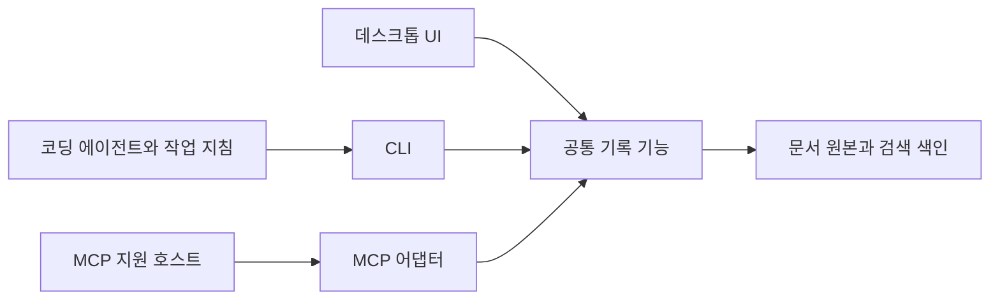

# AI 에이전트 도구에서 CLI 활용이 확대되는 이유

- 조사일: 2026-11-01, Asia/Seoul
- 질문: 왜 최근 MCP보다 CLI를 중심으로 도구를 만드는 흐름이 주목받는가?
- 범위: AI 에이전트가 외부 기능을 호출하는 인터페이스. 코딩·로컬 자동화와 원격 서비스 연동을 비교한다.
- 방법: 공식 저장소·표준·공급자 기술 글과 연구 초록을 대조했다. 제품 설치, 유료 모델 호출, 벤치마크 재현은 수행하지 않았다.
- 상태: 1차 조사 완료. 시장 점유율과 SiloLink의 실제 성능 우위는 미확인.

## 1. 결론과 전제

**CLI가 주목받는 주된 이유는 코딩 에이전트가 이미 쓰는 셸·파일·코드 실행 환경을 통해 기존 도구를 재사용하고, 필요한 설명과 결과만 모델에 전달하기 쉬워졌기 때문이다.** CLI에 업무 절차를 설명하는 Skills를 붙이면 별도 도구 호출 체계를 크게 늘리지 않고도 기능을 배포할 수 있다. 이 설명은 아래 제품 사례와 실행 방식에서 도출한 해석이며, 산업 전체의 채택률을 측정한 결과는 아니다.

직접적인 사례는 Microsoft의 Playwright CLI다. 공식 README는 코딩 에이전트에 CLI+Skills가 적합하다고 설명하며, 큰 도구 스키마와 페이지 정보를 컨텍스트에 넣지 않는 점을 이유로 제시한다. 동시에 MCP의 활용 조건도 남겨 두고 있다. [Playwright CLI 공식 README](https://github.com/microsoft/playwright-cli#playwright-cli-vs-playwright-mcp)

그러나 **“CLI가 MCP를 대체하고 있다”, “CLI는 항상 더 싸고 안전하다”는 결론을 지지할 근거는 부족하다.** MCP도 도구 검색과 코드 실행을 결합해 같은 비용 문제를 줄이고 있다. Cloudflare의 Code Mode가 그 사례다. [Cloudflare Code Mode](https://blog.cloudflare.com/code-mode/)

질문의 “크게 확장된다”는 전제는 다음과 같이 나눠야 한다.

| 판단 | 이번 조사에서 확인한 범위 |
| --- | --- |
| 에이전트를 대상으로 CLI+Skills를 제공하는 사례가 있다 | 공식 저장소에서 확인 |
| 대량 도구 정의와 중간 결과가 컨텍스트 부담을 만든다 | 공급자 기술 글과 특정 실험에서 확인 |
| CLI의 채택 성장률이 MCP보다 높다 | 비교 가능한 시계열 통계 미확보 |
| 모든 작업에서 CLI가 더 효율적이다 | 지지되지 않음. 실행기·작업·탐색 방식에 따라 달라짐 |

## 2. 무엇과 무엇을 비교하는가

CLI는 명령행으로 프로그램을 조작하는 인터페이스다. MCP는 에이전트와 외부 도구·데이터를 연결하는 표준 프로토콜이다. 같은 계층의 완전한 대체재로 보면 판단이 흐려진다.

특히 다음 두 CLI를 구별해야 한다.

- **에이전트 자체의 CLI**: 사람이 터미널에서 AI 작업을 시작하는 실행 환경.
- **에이전트가 호출하는 CLI**: `gh`, `git`, 제품 자체 명령 등 업무 기능을 수행하는 도구. 이 문서의 주 비교 대상이다.

터미널에서 실행되는 에이전트도 MCP를 사용할 수 있고, MCP 서버 안에서 CLI를 실행할 수도 있다. MCP는 로컬 subprocess의 표준 입출력인 stdio와 Streamable HTTP를 모두 지원하므로, “CLI=로컬, MCP=원격”이라는 구분도 맞지 않는다. [MCP Transports, 2026-07-28](https://modelcontextprotocol.io/specification/2026-07-28/basic/transports)

| 구성 요소 | 담당하는 일 | 다른 요소와의 관계 |
| --- | --- | --- |
| CLI | 명령·옵션·입출력·종료 코드로 기능 제공 | 셸, 스크립트, 에이전트에서 재사용 |
| MCP | 도구 발견·호출·스키마·응답 등의 공통 계약 제공 | 내부 구현은 API·SDK·CLI 등을 사용할 수 있음 |
| Skill | 언제 어떤 절차로 도구를 쓸지 설명 | CLI와 MCP 어느 쪽에도 적용 가능 |
| 실행기·샌드박스 | 프로세스·파일·네트워크·허용 범위 관리 | CLI와 코드 실행형 MCP 모두의 실제 행동 범위를 결정 |

MCP의 도구는 이름과 스키마 메타데이터를 가지며, 도구 목록과 호출 메시지가 표준화되어 있다. 반면 Skill은 지침과 스크립트·참고 자료를 묶어 필요할 때 불러오는 형식이다. [MCP Tools](https://modelcontextprotocol.io/specification/2026-07-28/server/tools), [Agent Skills 개요](https://agentskills.io/home)

## 3. 왜 지금 CLI가 다시 유리해 보이는가

### 3.1 도구 설명을 전부 미리 읽히는 비용이 드러났다

외부 도구가 많아지면 모델에 제공하는 설명·인자 스키마가 커진다. 작업에 쓰지 않는 기능까지 제시하는 구현에서는 실제 일을 시작하기 전부터 컨텍스트를 많이 쓴다. Anthropic은 이 문제와 중간 결과의 반복 전달을 MCP 확장 시의 두 가지 비용 요인으로 설명했다. [Anthropic: Code execution with MCP, 2025-11-04](https://www.anthropic.com/research/code-execution-with-mcp)

CLI에서는 상위 도움말을 읽고 필요한 하위 명령의 사용법만 확인하는 식의 탐색이 가능하다. 이것이 도움이 되는 이유는 **명령 문자열이 짧아서만이 아니라, 모델이 읽는 기능 설명의 범위를 줄일 수 있어서**다. 다만 처음 보는 CLI의 도움말을 여러 번 탐색하거나 옵션을 잘못 추측하면 절감분을 다시 쓸 수 있다. 이 부분은 인터페이스 설계에 관한 해석이다.

MCP의 `tools/list`로 목록을 얻는 것과 그 목록 전체를 모델 프롬프트에 넣는 것은 별개다. 전부 주입하는 방식을 프로토콜의 필수 비용으로 취급해서는 안 된다. [MCP Tools](https://modelcontextprotocol.io/specification/2026-07-28/server/tools)

### 3.2 데이터 가공을 모델 밖에서 끝내기 쉽다

예를 들어 GitHub CLI는 지원 명령에서 `--json`으로 필요한 필드를 고르고, `--jq`로 결과를 필터링할 수 있다. 다음은 사용법을 설명하는 읽기 전용 예시이며 이 조사에서 실행하지 않았다. [GitHub CLI 출력 형식 문서](https://cli.github.com/manual/gh_help_formatting)

```sh
gh pr list --state open --limit 20 --json number,title --jq '.[] | {number, title}'
```

이 방식에서는 전체 응답을 모델에 보여 준 뒤 다시 추려 달라고 할 필요가 없다. 반복·정렬·변환·파일 저장도 코드나 스크립트에서 처리하고, 모델에는 판단에 필요한 결과만 돌려줄 수 있다. 이는 CLI가 제공하기 쉬운 장점이지만 MCP에도 구현할 수 있다. Cloudflare는 MCP 도구를 TypeScript API로 표현해 여러 호출을 코드로 묶는 방식을 제시했다. [Cloudflare Code Mode](https://blog.cloudflare.com/code-mode/)

중요한 비용은 JSON-RPC 메시지 몇 바이트보다 **모델이 읽고 다시 생성하는 설명과 데이터의 양, 모델 왕복 횟수**다. 이 해석에 따르면 CLI가 거대한 JSON을 매번 그대로 출력하면 이점이 줄어든다.

### 3.3 기존 개발 도구와 작업 절차를 재사용할 수 있다

개발 작업은 파일·테스트·버전 관리·빌드 명령을 자주 묶는다. 이미 셸 실행 권한과 환경이 있는 에이전트라면 같은 환경에서 제품 CLI를 호출할 수 있다. 개발자는 기존 명령을 사람·스크립트·CI와 공유하고, 실패한 명령을 직접 재실행해 조사할 수 있다.

**해석:** 이런 조건에서는 MCP 전용 어댑터, 클라이언트 설정, 지원 도구 목록을 추가하는 것보다 CLI부터 제공하는 개발·디버깅 비용이 낮을 수 있다. 반대로 기존 MCP 플랫폼이 인증과 배포를 제공한다면 MCP가 더 간단할 수 있다. MCP stdio 서버도 로컬 실행이므로 항상 별도의 원격 서버 운영이 필요한 것은 아니다. [MCP Transports](https://modelcontextprotocol.io/specification/2026-07-28/basic/transports)

Cloudflare는 모델이 익숙한 프로그래밍 언어를 통해 복잡한 도구를 다루기 쉽다는 관찰도 제시했다. 학습 데이터의 코드가 많은 것이 이유일 수 있다는 설명은 공급자의 가설이며, “모든 모델이 CLI를 더 잘 안다”는 입증은 아니다. [Cloudflare Code Mode](https://blog.cloudflare.com/code-mode/)

### 3.4 Skills가 업무 절차를 전달하는 역할을 보완한다

CLI가 있어도 모델이 그 도구를 언제 사용하고 어떤 순서로 검증해야 하는지는 별도의 지식이다. Skills는 이 절차를 문서·스크립트로 배포한다. 공식 형식은 처음에 이름과 설명을 제공하고, 관련 작업이 생기면 본문과 필요한 자료를 읽는 점진적 로딩을 설명한다. [Agent Skills 개요](https://agentskills.io/home)

**해석:** 제품 제공자는 CLI로 실행 기능을 만들고 Skill에 사용 조건·예제·복구 절차를 담을 수 있다. 이미 CLI가 있는 제품에는 배포 진입점이 하나 더 생기는 셈이다. Skill이 MCP를 호출할 수도 있으므로 Skills 확산 자체를 MCP 감소의 증거로 삼을 수는 없다.

### 3.5 사람용 CLI에서 에이전트용 인터페이스로 설계가 확장된다

`googleworkspace/cli`의 `gws`는 사람과 AI 에이전트를 함께 대상으로 설명한다. 구조화 JSON, 메서드 스키마 조회, 도움말, dry-run, Skills를 제공하며 Discovery Service에서 명령 표면을 생성한다. 이는 CLI도 구조화·발견 가능성을 갖출 수 있음을 보여 준다. 단, README는 **Google의 공식 지원 제품이 아니며 개발 중 변경이 있을 수 있다**고 명시한다. [Google Workspace CLI 공식 저장소](https://github.com/googleworkspace/cli)

**해석:** 최근의 변화는 단순히 예전 터미널 도구로 돌아가는 것이 아니다. 자동화하기 좋은 출력, 요청 미리보기, 명시적 오류와 작업 지침을 갖춘 CLI를 에이전트의 인터페이스로 다시 설계하는 흐름으로 볼 수 있다.

## 4. 확산을 뒷받침하는 사례와 반대 증거

| 사례·시점 | 직접 확인한 내용 | 해석의 한계 |
| --- | --- | --- |
| Playwright CLI, 조사일 README | 코딩 에이전트에 CLI+Skills 권장, 컨텍스트 효율을 이유로 제시 | 프로젝트의 권고이며 전체 시장의 점유율 자료는 아님 |
| Google Workspace CLI, 조사일 README | 사람·AI 에이전트 대상 CLI, JSON·스키마·Skills 제공 | 공식 지원 제품 아님. MCP에서 전환했다는 근거는 아님 |
| Cloudflare Code Mode, 2025-09-26 | MCP 호출을 코드로 구성하는 방식 제시 | CLI 전환 사례가 아니라 MCP 활용 방식의 변화 |
| Anthropic advanced tool use, 2025-11-24 | Tool Search로 도구 정의를 필요할 때 로딩 | 클라이언트·플랫폼 구현에 따라 적용 여부가 다름 |

사례 근거: [Playwright](https://github.com/microsoft/playwright-cli), [Workspace CLI](https://github.com/googleworkspace/cli), [Cloudflare](https://blog.cloudflare.com/code-mode/), [Anthropic advanced tool use](https://www.anthropic.com/research/advanced-tool-use).

특히 Cloudflare의 현재 MCP 저장소는 약 2,500개 API 엔드포인트를 Code Mode로 제공하면서 도구 정의 비용을 약 1,100토큰으로 제시한다. 이는 공급자가 제시한 **인터페이스 정의 비용**이며 작업 전체의 토큰이나 성공률 비교가 아니다. MCP도 작은 도구 표면을 유지할 수 있다는 반례로 읽는 것이 적절하다. [Cloudflare MCP README의 Token Comparison](https://github.com/cloudflare/mcp/blob/main/README.md#token-comparison)

## 5. “CLI가 몇 배 싸다”는 수치의 읽는 법

### 5.1 Scalekit 실험: 차이는 컸지만 특정 구성의 결과다

2026-03-11 글은 Sonnet 4로 GitHub 읽기 작업 5개를 CLI·CLI+Skills·MCP 각각 반복한 총 75회 실험을 보고했다. MCP에는 도구 스키마 43개를 제공했다. 작업별 중앙값에서 MCP 토큰이 일반 CLI의 약 4~32배였으며, MCP 25회 중 7회 실패는 모두 연결 시간 초과라고 설명한다. **프로토콜 오류나 모델의 잘못된 도구 호출로 인한 실패는 아니었다.** [Scalekit 실험 보고](https://www.scalekit.com/blog/mcp-vs-cli-use)

일반화에는 다음 제한이 있다.

- 전체 스키마를 제공하는 구성이다. 도구 검색·스키마 필터링을 적용한 MCP와의 공정한 최적화 비교로 볼 수 없다.
- 원격 MCP 연결 문제와 프로토콜 차이를 구분해야 한다. CLI도 GitHub API를 사용하므로 네트워크 장애에서 자유롭지 않다.
- 한 모델, 한 서비스, 작은 작업 집합의 결과다. 다른 에이전트나 새 CLI에 그대로 적용할 수 없다.
- 공급자 자체 실험이며 이번 조사에서 재현하지 않았다. 글의 결과를 독립 검증 수치로 표시하지 않는다.

공개 저장소 README는 별도의 **단일 실행** 결과를 제시하며 블로그의 중앙값과 수치가 다르다. 또한 저장소 요약에는 작업별 30회 방법론이 나오지만 해당 블로그 실험은 방식별·작업별 5회다. 동일한 실험 집계로 합치지 않았다. [Scalekit 벤치마크 저장소](https://github.com/scalekit-inc/mcp-vs-cli-benchmark)

### 5.2 더 넓은 비교는 실행기의 영향을 보여 준다

2026-08-09 arXiv에 제출된 연구의 초록은 에이전트 실행기 7개·모델 5개·고정 소프트웨어 작업 1개를 비교했다고 보고한다. 엄격히 짝지은 MCP/CLI 비용 비율 13개가 0.43배에서 29배까지 벌어졌고, 실행기 자체가 큰 영향을 주었다고 설명한다. 에이전트가 지정 인터페이스를 무시하는 현상도 보고했다. [연구 초록: The Scaffolding Matters More Than the Interface](https://arxiv.org/abs/2608.08654)

이 연구도 작업 종류가 하나이고, 본 조사에서는 초록만 확인했다. 전체 방법론·원시 데이터 재검토와 재현을 거친 확정 결론으로 취급하지 않는다. 그래도 **인터페이스 이름만으로 비용 우위를 예측하면 안 된다**는 점을 뒷받침한다.

### 5.3 MCP 내부 최적화 수치를 CLI 우위로 오인하면 안 된다

Anthropic은 MCP에 코드 실행과 필요한 정의만 읽는 방식을 적용한 예시에서 150,000→2,000토큰, 98.7% 감소를 제시했다. 이는 CLI와 MCP를 비교한 평균 성능이 아니다. [Code execution with MCP](https://www.anthropic.com/research/code-execution-with-mcp)

다른 글의 Tool Search 약 85% 감소 역시 해당 구성에서의 공급자 측정이다. 따라서 두 수치를 “MCP를 CLI로 바꾸면 보장되는 절약률”로 인용해서는 안 된다. [Introducing advanced tool use](https://www.anthropic.com/research/advanced-tool-use)

실제 비용은 다음 항목을 나눠 측정해야 한다.

| 항목 | 확인할 것 |
| --- | --- |
| 설명·탐색 | 도구 스키마, Skill 본문, 도움말 탐색량 |
| 데이터 | 모델에 들어간 중간 결과와 최종 결과 크기 |
| 실행 | 모델 왕복, 재시도, 인증·연결 지연 |
| 요금 | 입력·출력·캐시 토큰과 실제 청구 기준 |
| 완결성 | 최종 상태의 정확성, 실패 비용, 사람의 복구 시간 |

## 6. CLI와 MCP가 각각 유리한 조건

아래는 표준 기능과 앞선 사례를 바탕으로 한 선택 가이드다. 제품별 검증을 대신하지 않는다.

| 조건 | 우선 검토 | 이유·확인할 점 |
| --- | --- | --- |
| 로컬 개인 개발, 파일·Git·테스트를 함께 처리 | CLI+Skill | 이미 있는 실행 환경과 작업 절차 재사용 |
| 대량 결과를 필터링·변환·파일 저장 | CLI 또는 코드 실행형 MCP | 중간 데이터를 모델 밖에서 처리하는지가 핵심 |
| 셸이 없는 채팅 호스트에 기능 제공 | MCP | 호스트가 지원하는 표준 연결 경로 활용 |
| 여러 MCP 호스트에 같은 도구 제공 | MCP | 발견·호출 계약 재사용. 호스트별 지원 차이는 검증 필요 |
| 고객별 원격 계정에 위임된 권한으로 접근 | 인증된 원격 MCP 또는 별도 인증 API | 사용자·조직별 권한과 철회·격리가 필요 |
| 입력 스키마를 기반으로 도구를 선택·검증 | MCP가 자연스러움 | CLI도 스키마·JSON·명시적 오류로 보완 가능 |
| 오랜 실행·상태·취소가 중요 | 실제 구현 비교 | CLI도 세션·데몬을 쓸 수 있고 MCP도 상태 관리가 자동 완성되지는 않음 |

인증과 보안은 특히 과장하기 쉽다. MCP의 HTTP 인증 사양은 리소스 소유자를 대신한 접근을 다루지만 인증 지원 자체는 선택 사항이며, stdio는 이 HTTP 인증 절차 대신 환경에서 자격증명을 얻도록 설명한다. **MCP를 사용한다고 사용자별 권한·조직 격리·감사 로그가 자동 완성되는 것은 아니다.** [MCP Authorization, 2026-07-28](https://modelcontextprotocol.io/specification/2026-07-28/basic/authorization)

반대로 CLI도 OAuth를 사용할 수 있다. Workspace CLI에 실제 OAuth 흐름이 있다. CLI냐 MCP냐보다 자격증명 범위, 실행 샌드박스, 서버의 권한 검사와 로그 구현을 봐야 한다. [Workspace CLI Authentication](https://github.com/googleworkspace/cli#authentication)

**해석:** 임의 셸 실행 권한은 넓은 행동 범위를 줄 수 있으므로 CLI가 본질적으로 더 안전하다고 할 수 없다. 제한된 도구 계약은 검토를 쉽게 할 수 있지만, MCP에 범용 실행 도구를 노출하면 그 도구의 권한 범위를 다시 검토해야 한다.

## 7. SiloLink에 적용할 때의 제안

이 절은 기존 [인계 맥락](../context/silolink/CONTEXT.md)을 참고한 **미확정 제안**이다. 사용자 대상, 제품 범위, 구현 우선순위의 결정은 아니다.

로컬 프로젝트의 리서치 기록을 여러 코딩 에이전트에서 저장·검색하는 것이 첫 사용 사례라면 **공통 기록 기능을 만들고 얇은 CLI로 먼저 연결하는 접근**은 검토할 가치가 있다. CLI에 업무 지침을 붙여 실제 작업을 검증하고, 셸이 없는 호스트나 원격 서비스 요구가 생기면 같은 기능을 MCP 어댑터로 제공할 수 있다.



도식은 책임 관계를 나타낸다. 별도 서버·언어·DB를 정한 배포 설계가 아니다. CLI나 MCP 어댑터마다 저장·검증 로직을 중복 구현하지 않는 것이 이 제안의 목적이다.

CLI를 검토한다면 우선 필요한 계약은 다음 정도다.

- 구조화 출력과 안정적인 문서·프로젝트 식별자.
- 필요한 필드·결과 수 제한과 큰 본문의 파일 입출력.
- 비대화형 실행, 명시적 오류·종료 코드, 호환 버전 확인.
- 중복 저장 방지와 대상 프로젝트 확인. 쓰기 작업의 확인·취소 방식.
- 기본 출력에 민감한 본문이나 자격증명을 포함하지 않는 정책.

이 목록은 기대 효과를 내기 위한 설계 제안이다. 현재 SiloLink에 구현되어 있다는 뜻은 아니다.

### 다음에 검증할 것

동일한 기록 기능을 CLI와 MCP로 노출한 작은 시제품에서 다음 작업을 비교하면 선택 근거를 얻을 수 있다. 이번 리서치에는 구현이나 실행을 포함하지 않았다.

1. 프로젝트 기록 검색 → 근거 문서 일부 읽기.
2. 긴 리서치 파일 저장 → 같은 요청 재실행 시 중복 여부 확인.
3. 문서 여러 개를 조회 → 비교 요약용 자료만 추출.
4. 잘못된 프로젝트·권한 부족·부분 실패에서 복구.

각 방식에 최소 노출과 과다 노출 조건을 두고, 같은 모델·작업·완료 기준을 사용한다. 도움말·Skill·스키마 탐색 비용도 포함하고, 실제로 어느 인터페이스를 사용했는지 로그로 확인한다. 결과는 최종 저장 상태, 토큰·지연, 사람의 복구 시간으로 평가한다. MCP에만 불필요한 스키마 수십 개를 붙이거나 CLI의 사전 설명을 비용에서 빼는 비교는 피한다.

## 8. 출처와 조사 한계

아래는 모두 2026-11-01에 열람했다. GitHub의 `main` README와 일반 웹 문서는 이후 바뀔 수 있다. 표준은 조사 시 `latest`가 가리킨 2026-07-28 버전을 명시했다.

| 출처 | 유형·시점 | 사용 범위와 한계 |
| --- | --- | --- |
| [Microsoft Playwright CLI](https://github.com/microsoft/playwright-cli) | 공식 저장소, 조사일 상태 | CLI+Skills 권고. 공급자 판단이며 시장 통계 아님 |
| [Google Workspace CLI](https://github.com/googleworkspace/cli) | 프로젝트 공식 저장소, 조사일 상태 | JSON·스키마·Skills·OAuth. Google 공식 지원 제품 아님 |
| [GitHub CLI formatting](https://cli.github.com/manual/gh_help_formatting) | 공식 문서, 조사일 상태 | 필드 선택·JSON·jq 사용법 |
| [Agent Skills 개요](https://agentskills.io/home) | 형식 공식 문서, 조사일 상태 | 지침 패키지와 점진적 로딩 |
| [MCP Tools](https://modelcontextprotocol.io/specification/2026-07-28/server/tools) | 표준 사양, 2026-07-28 | 도구 정의·발견·호출 계약 |
| [MCP Transports](https://modelcontextprotocol.io/specification/2026-07-28/basic/transports) | 표준 사양, 2026-07-28 | stdio·HTTP 구분 |
| [MCP Authorization](https://modelcontextprotocol.io/specification/2026-07-28/basic/authorization) | 표준 사양, 2026-07-28 | HTTP 위임 인증과 선택적 지원 |
| [Cloudflare Code Mode](https://blog.cloudflare.com/code-mode/) | 공급자 기술 글, 2025-09-26 | MCP를 코드로 호출하는 설계·공급자 관찰 |
| [Cloudflare MCP README](https://github.com/cloudflare/mcp/blob/main/README.md) | 공식 저장소, 조사일 상태 | 정의 토큰 비교. 전체 작업 비용 아님 |
| [Anthropic Code execution with MCP](https://www.anthropic.com/research/code-execution-with-mcp) | 공급자 기술 글, 2025-11-04 | 정의·중간 데이터 부담과 코드 실행 예시 |
| [Anthropic advanced tool use](https://www.anthropic.com/research/advanced-tool-use) | 공급자 기술 글, 2025-11-24 | 도구 검색·지연 로딩. 공급자 측정 |
| [Scalekit 실험 보고](https://www.scalekit.com/blog/mcp-vs-cli-use) | 공급자 자체 실험, 2026-03-11 | 특정 구성의 75회 결과. 재현하지 않음 |
| [Scalekit 벤치마크 저장소](https://github.com/scalekit-inc/mcp-vs-cli-benchmark) | 실험 공개 저장소, 조사일 상태 | README와 블로그의 집계 차이 확인. 코드·데이터 전체 감사 아님 |
| [The Scaffolding Matters More Than the Interface](https://arxiv.org/abs/2608.08654) | arXiv 사전공개 연구, 2026-08-09 | 초록 확인. 전문 검토·동료심사 확인·재현 미수행 |

남은 불확실성은 시장 전체의 상대적 성장률, 동일 작업에 최적화한 두 인터페이스의 우열, SiloLink 사용자의 실제 호스트·인증 요구다. 이 세 항목이 확인되기 전에는 “CLI 우선 검토”를 제품 전략의 확정 결론으로 바꾸지 않는다.

## 갱신 이력

| 날짜 | 변경 |
| --- | --- |
| 2026-11-01 | 최초 조사. 공식 사례·비용 메커니즘·실험 한계·SiloLink 적용 제안 정리 |
